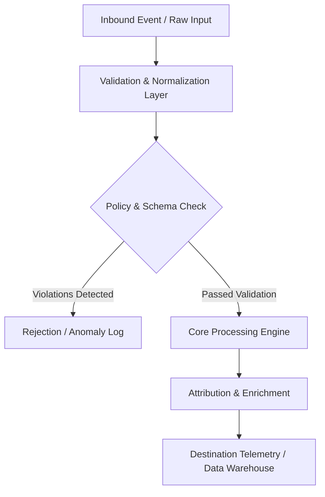

# Packaging Print Specifications

## Architecture Specification: D2C Post-Purchase Unboxing Experience & Referral Architecture
This document defines the technical architecture and event flow for **D2C Post-Purchase Unboxing Experience & Referral Architecture** within the **e-commerce** domain.

### Operational Context
Build an open-source post-purchase unboxing experience and referral system: 1) Physical unboxing architecture blueprint (Sensory cues, Branded tape, Tissue wrap, Thank-you note placement), 2) 10 physical package insert copy templates with dynamic QR referral mechanics, 3) UTM tracking architecture for measuring package-driven repurchases, 4) Packaging supplier specification cheat sheet.

---

## System Architecture & Data Flow

## Functional Components

### 1. Ingestion & Normalization Layer
- Captures raw telemetry, webhooks, or file exports.
- Strips whitespace, normalizes regional casing, and sanitizes phone numbers and email strings into E.164 and SHA-256 formats.

### 2. Processing & Business Logic Rules
- Applies deterministic rule engines or statistical models without external black-box dependencies.
- Handles missing or delayed event attributes using bounded lookback windows.

### 3. Output Delivery & Error Handling
- Returns structured JSON payloads with machine-readable error codes and status telemetry.
- Employs exponential backoff retry logic (3 attempts: 1s, 5s, 15s) for downstream webhook delivery.

---
*Operational standard maintained by @mahmoudabdelnaby1.*
